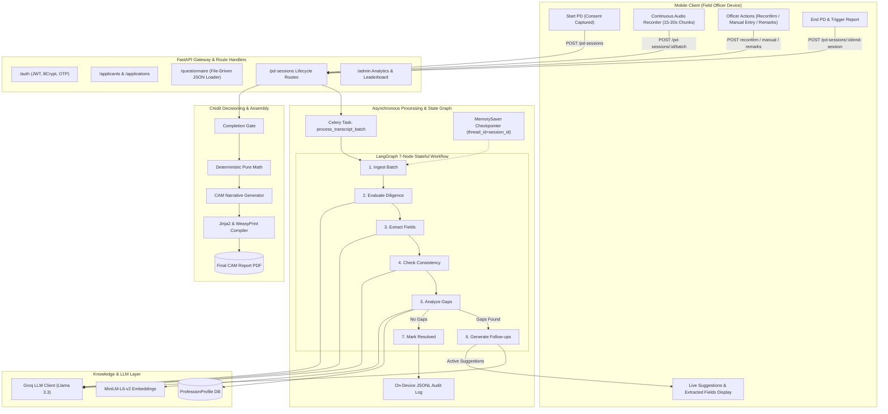
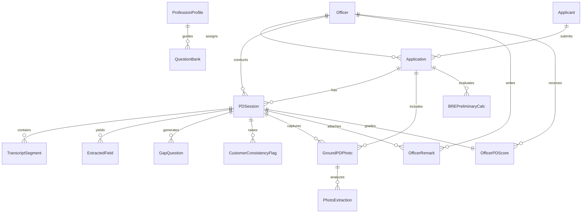

# MSFincap Phase 1 — Comprehensive Architecture, Code & Integration Reference

This document provides a complete technical reference for the **MSFincap Phase 1 In-Person Personal Discussion (PD) Platform**. It details everything implemented to date, the complete data models and validation schemas, their exact interconnections, the end-to-end architectural flow, and the integration contracts reserved for Riddhi.

---

## Table of Contents

1. [Executive Summary & Completed Scope](#1-executive-summary--completed-scope)
2. [End-to-End Architectural Flow & Lifecycle](#2-end-to-end-architectural-flow--lifecycle)
   - [2.1 High-Level Architecture Diagram](#21-high-level-architecture-diagram)
   - [2.2 Detailed Step-by-Step Flow](#22-detailed-step-by-step-flow)
3. [Database Models, Schemas & Relationships](#3-database-models-schemas--relationships)
   - [3.1 Relational Schema & Entity-Relationship Model](#31-relational-schema--entity-relationship-model)
   - [3.2 Detailed Breakdown of All 15 SQLAlchemy Models](#32-detailed-breakdown-of-all-15-sqlalchemy-models)
   - [3.3 Pydantic Schemas & API Data Contracts](#33-pydantic-schemas--api-data-contracts)
   - [3.4 Model-to-Schema Mapping & Foreign Key Interconnections](#34-model-to-schema-mapping--foreign-key-interconnections)
4. [Deep Dive: Core Code Modules & Agents](#4-deep-dive-core-code-modules--agents)
   - [4.1 Pure Deterministic Financial Calculations](#41-pure-deterministic-financial-calculations)
   - [4.2 File-Driven Questionnaire System](#42-file-driven-questionnaire-system)
   - [4.3 RAG Knowledge Base & Embeddings Engine](#43-rag-knowledge-base--embeddings-engine)
   - [4.4 Groq LLM Client & Vision Layer](#44-groq-llm-client--vision-layer)
   - [4.5 LangGraph 7-Node Stateful Pipeline & Checkpointer](#45-langgraph-7-node-stateful-pipeline--checkpointer)
   - [4.6 Dual Independent Scoring Engine](#46-dual-independent-scoring-engine)
   - [4.7 Core Utilities (PII, Image Hashing, Completion Gate)](#47-core-utilities-pii-image-hashing-completion-gate)
   - [4.8 Credit Report Assembly & PDF Compilation](#48-credit-report-assembly--pdf-compilation)
   - [4.9 Admin & Portfolio Quality Analytics](#49-admin--portfolio-quality-analytics)
5. [What is Left for Riddhi (Integration Contracts & Scope)](#5-what-is-left-for-riddhi-integration-contracts--scope)
   - [5.1 Riddhi's Scope Definition](#51-riddhis-scope-definition)
   - [5.2 Integration Contract 1: Speech-to-Text (`transcribe_audio_stub`)](#52-integration-contract-1-speech-to-text-transcribe_audio_stub)
   - [5.3 Integration Contract 2: Vision Extraction (`extract_photo_stub`)](#53-integration-contract-2-vision-extraction-extract_photo_stub)
   - [5.4 Seamless Plug-in Guarantees](#54-seamless-plug-in-guarantees)
6. [Verification & Test Suite Coverage](#6-verification--test-suite-coverage)

---

## 1. Executive Summary & Completed Scope

The MSFincap Phase 1 platform digitizes and automates the in-person Personal Discussion (PD) underwriting process for Micro, Small, and Medium Enterprises (MSME).

### Core Foundational Principles
1. **Physical Ground PD Focus**: Strictly tailored for physical verification visits. Tele-PD and telephony integrations are outside Phase 1 scope.
2. **Pure Deterministic Financial Math**: Arithmetic calculations (EMI, FOIR, LTV) are 100% pure Python functions. **No LLM is ever used for financial arithmetic**, ensuring deterministic auditability.
3. **Continuous Voice Recording & Batch Processing**: Officers initiate a single continuous audio recording during the interview. Audio or transcripts stream to the backend in 15–20s batches, enabling real-time assistance while preserving natural conversational flow.
4. **RAG as Domain Knowledge (No Static Follow-Up Banks)**: RAG stores business benchmarks (gross margins, inventory turnover) and profession checklists ("What info is needed for Kirana/Manufacturing/Transport"). Dynamic follow-up questions are generated by the AI in real time based on conversation gaps.
5. **Decoupled Scoring Architecture**: Customer consistency (borrower contradictions across statements) and officer performance (diligence, suggestion uptake, proactive bonus) are completely isolated from each other.
6. **Proactive Diligence Bonus**: Officers receive bonus points for asking intelligent, unprompted underwriting questions that show genuine credit curiosity.
7. **Local Tamper-Evident Audit Logging**: Every batch, state change, and LLM output appends to an on-device JSONL audit log (`logs/pd_session_{id}.jsonl`).

---

## 2. End-to-End Architectural Flow & Lifecycle

### 2.1 High-Level Architecture Diagram



### 2.2 Detailed Step-by-Step Flow

#### Step 1: Authentication & Case Intake
1. Field Officer or Credit Underwriter logs in via `POST /auth/login` (or OTP flow via `/auth/send-otp` and `/auth/verify-otp`). A JWT bearer token is issued.
2. The applicant profile is ingested via `POST /applicants` (e.g., Vikram Singh, Retail Kirana Store).
3. The loan application is created via `POST /applications` with requested loan amount, tenure, product type, and interest rate.
4. The system provides baseline questions via `GET /questionnaire/{employment_type}` by dynamically loading modular JSON files from `data/questions/*.json`.

#### Step 2: Ground PD Session Initialization
1. When the officer meets the borrower on-site, borrower consent is captured.
2. The client calls `POST /pd-sessions` with `application_id`, `officer_id`, and `consent_captured=True`.
3. The backend logs the consent timestamp, transitions the Application status to `PD_IN_PROGRESS`, and initializes a `PDSession` record with `is_session_active=True`.

#### Step 3: Real-Time Audio Batch Streaming & LangGraph Orchestration
1. During the interview, audio records continuously. Every 15–20 seconds, an audio chunk or preliminary transcript segments are posted to `POST /pd-sessions/{session_id}/batch`.
2. The endpoint delegates processing to `process_transcript_batch` (handled asynchronously by Celery or executed directly inline).
3. The **LangGraph 7-Node Pipeline** executes against the checkpoint for that session (`thread_id=session_id`):
   - **Node 1 (`ingest_batch`)**: Appends segments to `transcript_history`, eliminating duplicate segments via timestamp tuple `(start_time, end_time, text)`.
   - **Node 2 (`evaluate_diligence`)**: Runs a single combined prompt to check:
     - *Uptake*: Did the officer ask any active follow-up questions? If yes, moves question to `resolved_followup_questions`.
     - *Proactive Diligence Bonus*: Did the officer ask an unprompted, insightful credit question? If yes, awards `officer_proactive_bonus_points`.
   - **Node 3 (`extract_fields`)**: Identifies declared or inferred financial facts (`monthly_turnover`, `net_margin_pct`, `daily_sales`, `customer_footfall`). Flags numeric fields for officer reconfirmation.
   - **Node 4 (`check_consistency`)**: Compares newly stated facts with previous transcript history to detect borrower contradictions (e.g., claiming Rs. 20L annual sales after earlier reporting Rs. 2,000 daily sales). Categorizes severity as `LOW`, `MEDIUM`, or `HIGH`.
   - **Node 5 (`analyze_gaps`)**:
     - *Cost Guard*: If the new batch contains fewer than 15 words, skips expensive LLM evaluation.
     - *RAG Context Evaluation*: Compares extracted fields against the RAG checklist (`required_info_checklist_json`). Sets `gaps_remaining=True` if items are missing.
   - **Conditional Router**: Routes to `generate_followups` if gaps remain; otherwise routes to `mark_resolved`.
   - **Node 6 (`generate_followups`)**: Formulates dynamic, conversational Hindi/Hinglish questions addressing unfilled verification checklist items.
   - **Node 7 (`mark_resolved`)**: Reconciles resolved questions when all key items are answered.
4. **Persistence & Audit Logging**: `persist_batch_results` syncs segments, extracted fields, gap questions, customer consistency flags, and officer scores to the database and appends an immutable entry to `logs/pd_session_{session_id}.jsonl`.
5. The endpoint immediately returns the active follow-up questions for real-time mobile display.

#### Step 4: Officer In-Flight Actions & Fallbacks
- **Polling Fallback**: If WebSocket or push channels disconnect, the client polls `GET /pd-sessions/{session_id}/live-state`.
- **Numeric Field Reconfirmation**: The officer reviews extracted financial numbers on screen and calls `POST /pd-sessions/{session_id}/reconfirm` to confirm or adjust values.
- **Manual Field Entry**: For soft-spoken borrowers or noisy environments, the officer manually records fields via `POST /pd-sessions/{session_id}/manual-field`.
- **Officer Remarks**: Qualitative on-site observations (footfall, stock quality, neighborhood reputation) are submitted via `POST /pd-sessions/{session_id}/remarks`.

#### Step 5: Session Wrap-up & Completion Gate
1. The officer taps "End PD Session", posting to `POST /pd-sessions/{session_id}/end-session`.
2. The `check_completion` gate runs validation checks:
   - Validates that mandatory business/premises photos were captured.
   - Confirms minimum required discussion duration.
   - Ensures all required verification checklist items are addressed or marked.
3. If criteria pass, the session is marked completed, and application status moves to `PD_COMPLETED`.

#### Step 6: Automated CAM Credit Report Assembly
1. `assemble_report(session_id, db)` triggers:
   - Evaluates applicant profile, photo findings, transcript, and extracted fields.
   - Calls pure deterministic calculation functions (`calculate_emi`, `calculate_foir`, `calculate_ltv`).
   - Groq LLM generates formal credit narratives across 4 sections: Business & Operations, Financial Profile & Capacity, Risk Analysis & Inconsistencies, and Recommendation.
   - Jinja2 compiles the HTML template, and WeasyPrint generates the formal Credit Appraisal Memo PDF (`uploads/reports/CAM_Report_{case_number}.pdf`).

#### Step 7: Admin Portfolio & Quality Analytics
Supervisors and Quality Reviewers access `/admin` endpoints to inspect:
- Officer score distributions (`GET /admin/scores`).
- Contradiction trends and high-risk flags (`GET /admin/consistency-flags`).
- Operational pipeline bottlenecks (`GET /admin/cases`).
- Officer proactive diligence bonus leaderboard (`GET /admin/leaderboard`).

---

## 3. Database Models, Schemas & Relationships

### 3.1 Relational Schema & Entity-Relationship Model



### 3.2 Detailed Breakdown of All 15 SQLAlchemy Models

All models reside in `backend/app/models/` and inherit from `Base` (`app.core.database`):

#### 1. `Officer` (`app/models/officer.py`)
- **Table**: `officers`
- **Fields**: `id` (UUID pk), `name` (String), `phone` (String, unique, indexed; synonym `phone_number`), `hashed_password` (String), `role` (String: "officer" | "admin" | "underwriter"), `branch` (String), `is_active` (Boolean), `created_at` (DateTime).
- **Purpose**: System user account for field officers, credit underwriters, and admin quality reviewers.

#### 2. `Applicant` (`app/models/applicant.py`)
- **Table**: `applicants`
- **Fields**: `id` (UUID pk), `name` (String; synonym `full_name`), `phone` (String, indexed; synonym `phone_number`), `pan` (String, indexed; synonym `pan_number`), `aadhaar_hash` (String, nullable), `employment_type` (Enum: SALARIED | SELF_EMPLOYED), `business_category` (String; synonym `sub_profile`), `annual_income` (Float), `created_at` (DateTime).
- **Purpose**: Borrower demographic, identity, and baseline profession data.

#### 3. `Application` (`app/models/application.py`)
- **Table**: `applications`
- **Fields**: `id` (UUID pk), `case_number` (String, unique, indexed), `applicant_id` (UUID fk -> applicants.id), `assigned_officer_id` (UUID fk -> officers.id, nullable), `product_type` (String; synonym `loan_type`), `requested_amount` (Float), `tenure` (Integer; synonym `tenure_months`), `rate` (Float; synonym `interest_rate`), `property_market_value` (Float, nullable), `status` (Enum: LEAD_CREATED | PD_ASSIGNED | PD_IN_PROGRESS | PD_COMPLETED | APPROVED | REJECTED), `created_at` (DateTime).
- **Purpose**: The loan file being evaluated.

#### 4. `PDSession` (`app/models/pd_session.py`)
- **Table**: `pd_sessions`
- **Fields**: `id` (UUID pk), `application_id` (UUID fk -> applications.id), `officer_id` (UUID fk -> officers.id), `channel` (String: "ground"), `consent_captured` (Boolean), `consent_timestamp` (DateTime), `status` (String: "scheduled" | "in_progress" | "recorded" | "completed"), `is_session_active` (Boolean), `started_at` (DateTime), `ended_at` (DateTime, nullable), `audio_recording_path` (String, nullable), `pdf_report_path` (String, nullable), `created_at` (DateTime).
- **Purpose**: State container for a physical verification discussion.

#### 5. `TranscriptSegment` (`app/models/transcript_segment.py`)
- **Table**: `transcript_segments`
- **Fields**: `id` (UUID pk), `pd_session_id` (UUID fk -> pd_sessions.id; synonym `session_id`), `start_time` (Float), `end_time` (Float), `speaker` (String: "OFFICER" | "APPLICANT"), `text` (Text), `confidence` (Float), `created_at` (DateTime).
- **Purpose**: Individual timestamped dialogue turns parsed from the continuous audio stream.

#### 6. `ExtractedField` (`app/models/extracted_field.py`)
- **Table**: `extracted_fields`
- **Fields**: `id` (UUID pk), `pd_session_id` (UUID fk -> pd_sessions.id), `field_name` (String, indexed), `value` (Text), `source` (String: "stated" | "inferred" | "reconfirmed" | "manual"), `confidence_note` (Text, nullable), `officer_confirmed` (Boolean, default False), `created_at` (DateTime).
- **Purpose**: Extracted underwriting entities (turnover, margins, rent, credit cycle) tagged with provenance and officer confirmation status.

#### 7. `GapQuestion` (`app/models/gap_question.py`)
- **Table**: `gap_questions`
- **Fields**: `id` (UUID pk), `pd_session_id` (UUID fk -> pd_sessions.id), `question_text` (Text), `category` (String), `round_number` (Integer), `resolved` (Boolean, default False), `created_at` (DateTime).
- **Purpose**: Dynamic AI-generated follow-up questions active on the officer's screen.

#### 8. `CustomerConsistencyFlag` (`app/models/customer_consistency_flag.py`)
- **Table**: `customer_consistency_flags`
- **Fields**: `id` (UUID pk), `pd_session_id` (UUID fk -> pd_sessions.id), `field_name` (String), `value_a` (Text), `value_b` (Text), `severity` (String: "low" | "medium" | "high"), `resolution_note` (Text, nullable), `created_at` (DateTime).
- **Purpose**: Records borrower contradictions detected across statements (decoupled from officer scores).

#### 9. `OfficerPDScore` (`app/models/officer_pd_score.py`)
- **Table**: `officer_pd_scores`
- **Fields**: `id` (UUID pk), `pd_session_id` (UUID fk -> pd_sessions.id, unique), `officer_id` (UUID fk -> officers.id), `overall_score` (Float), `suggestion_uptake_score` (Float), `thoroughness_score` (Float), `bias_neutrality_score` (Float), `proactive_diligence_bonus` (Float, default 0.0), `breakdown_json` (JSON, nullable), `created_at` (DateTime).
- **Purpose**: Quantitative performance evaluation of the field officer's interview rigor.

#### 10. `GroundPDPhoto` (`app/models/ground_pd_photo.py`)
- **Table**: `ground_pd_photos`
- **Fields**: `id` (UUID pk), `pd_session_id` (UUID fk -> pd_sessions.id), `application_id` (UUID fk -> applications.id, nullable), `category` (String: "business_exterior" | "business_interior" | "stock" | "machinery"), `photo_path` (String), `gps_lat` (Float, nullable), `gps_lng` (Float, nullable), `dhash` (String(16), nullable), `captured_at` (DateTime).
- **Purpose**: Photographic evidence captured on-site with perceptual hash and GPS metadata.

#### 11. `PhotoExtraction` (`app/models/photo_extraction.py`)
- **Table**: `photo_extractions`
- **Fields**: `id` (UUID pk), `photo_id` (UUID fk -> ground_pd_photos.id), `asset_name` (String), `count` (Integer), `condition` (String), `verification_confidence` (Float), `created_at` (DateTime).
- **Purpose**: Output of automated vision inspection for physical equipment and inventory.

#### 12. `OfficerRemark` (`app/models/officer_remark.py`)
- **Table**: `officer_remarks`
- **Fields**: `id` (UUID pk), `pd_session_id` (UUID fk -> pd_sessions.id), `officer_id` (UUID fk -> officers.id), `open_remark_text` (Text; synonym `remark_text`), `business_health_sentiment` (String: "positive" | "neutral" | "negative"), `created_at` (DateTime).
- **Purpose**: Qualitative field remarks recorded by the visiting officer.

#### 13. `BREPreliminaryCalc` (`app/models/bre_preliminary_calc.py`)
- **Table**: `bre_preliminary_calcs`
- **Fields**: `id` (UUID pk), `application_id` (UUID fk -> applications.id), `computed_emi` (Float), `computed_foir` (Float), `computed_ltv` (Float, nullable), `max_allowable_loan` (Float, nullable), `created_at` (DateTime).
- **Purpose**: Business Rule Engine snapshot storing deterministic math calculations.

#### 14. `QuestionBank` (`app/models/question_bank.py`)
- **Table**: `question_bank`
- **Fields**: `id` (UUID pk), `employment_type` (Enum: SALARIED | SELF_EMPLOYED; synonym `category`), `business_category` (String; synonym `sub_profile`), `tier` (Integer: 1, 2, 3), `question_key` (String, unique, indexed), `question_text` (Text), `expected_field_name` (String, nullable), `is_mandatory` (Boolean), `created_at` (DateTime).
- **Purpose**: Baseline questions loaded from modular JSON files.

#### 15. `ProfessionProfile` (`app/models/profession_profile.py`)
- **Table**: `profession_profiles`
- **Fields**: `id` (UUID pk), `sub_profile` (String, unique, indexed), `display_name` (String), `benchmark_margins_json` (JSON), `required_info_checklist_json` (JSON), `red_flags_json` (JSON), `typical_questions_json` (JSON), `embedding` (JSON, nullable), `created_at` (DateTime).
- **Purpose**: Domain reference benchmarks and verification checklists used by RAG.

---

### 3.3 Pydantic Schemas & API Data Contracts

Schemas in `backend/app/schemas/` ensure validation and serialization:

| Schema File | Core Models | Usage |
|---|---|---|
| `auth.py` | `LoginRequest`, `TokenResponse`, `OTPVerifyRequest`, `OfficerResponse` | `/auth` endpoints |
| `applicant.py` | `ApplicantCreate`, `ApplicantResponse`, `ApplicantUpdate` | `/applicants` endpoints |
| `application.py` | `ApplicationCreate`, `ApplicationResponse`, `ApplicationStatusUpdate` | `/applications` endpoints |
| `pd_session.py` | `PDSessionStartRequest`, `PDSessionResponse`, `BatchTranscriptRequest`, `LiveStateResponse`, `NumericReconfirmRequest`, `ManualFieldEntryRequest`, `OfficerRemarkRequest`, `PDSessionEndResponse` | `/pd-sessions` endpoints |
| `extracted_field.py` | `ExtractedFieldCreate`, `ExtractedFieldResponse` | Field state management |
| `gap_question.py` | `GapQuestionCreate`, `GapQuestionResponse` | Active follow-up lists |
| `customer_consistency_flag.py` | `CustomerConsistencyFlagResponse` | Contradiction alerts |
| `officer_pd_score.py` | `OfficerPDScoreResponse`, `LeaderboardEntryResponse` | Scoring and admin views |
| `ground_pd_photo.py` | `GroundPDPhotoUploadResponse`, `GroundPDPhotoDetail` | Photo evidence |
| `bre_preliminary_calc.py` | `BRECalcResponse`, `CalculationInputSchema` | Financial calculation |
| `question_bank.py` | `QuestionBankItem`, `QuestionnaireResponse` | File-driven question banks |

---

## 4. Deep Dive: Core Code Modules & Agents

### 4.1 Pure Deterministic Financial Calculations
- **File**: [emi_foir_ltv.py](file:///c:/Users/Shashwat%20Gupta/Desktop/msfincap-phase1/backend/app/calculations/emi_foir_ltv.py)
- **Functions**:
  - `calculate_emi(principal, annual_interest_rate_pct, tenure_months) -> float`: Standard reducing balance amortisation formula:
    $$EMI = \frac{P \cdot r \cdot (1 + r)^n}{(1 + r)^n - 1}$$
    Handles zero-interest and zero-principal edge cases with complete mathematical rigor.
  - `calculate_foir(total_obligations_incl_new_emi, net_monthly_income) -> float`: Fixed Obligation to Income Ratio:
    $$FOIR = \frac{\text{Total Obligations}}{\text{Net Monthly Income}}$$
  - `calculate_ltv(loan_amount, property_market_value, is_secured=True) -> Tuple[Optional[float], str]`: Loan to Value ratio. Returns `(None, "NOT_APPLICABLE")` for unsecured loans, and `(None, "PENDING_VALUATION")` if market valuation is pending.
- **Critical Policy**: Zero LLM intervention. Guarantees deterministic auditability.

### 4.2 File-Driven Questionnaire System
- **Files**: Modular JSON files in `backend/app/data/questions/` (`kirana.json`, `manufacturing.json`, `salaried.json`, `services.json`), routed via [questionnaire.py](file:///c:/Users/Shashwat%20Gupta/Desktop/msfincap-phase1/backend/app/api/routes/questionnaire.py).
- **Behavior**: Auto-scans directory into `question_bank`. Adding questions requires adding/editing JSON files—no migrations or code rebuilds.

### 4.3 RAG Knowledge Base & Embeddings Engine
- **Files**: [chroma_client.py](file:///c:/Users/Shashwat%20Gupta/Desktop/msfincap-phase1/backend/app/rag/chroma_client.py), [ingest_profession_profiles.py](file:///c:/Users/Shashwat%20Gupta/Desktop/msfincap-phase1/backend/app/rag/ingest_profession_profiles.py), [retrieval.py](file:///c:/Users/Shashwat%20Gupta/Desktop/msfincap-phase1/backend/app/rag/retrieval.py)
- **Role & Vector DB**:
  - **Vector Database**: **ChromaDB** serves as the dedicated vector database (`chroma_db/`), storing document texts and embeddings with HNSW cosine distance indexing (`profession_profiles` collection).
  - RAG supplies domain knowledge: profit margin benchmarks, working capital cycles, and profession-specific verification checklists.
  - **No static follow-up question banks exist in RAG.**
  - Retrieval uses an exact match primary path on `sub_profile` from the relational DB with native semantic vector search fallback via ChromaDB. Auto-seeds profiles if the collection or table is uninitialized.

### 4.4 Groq LLM Client & Vision Layer
- **File**: [llm_client.py](file:///c:/Users/Shashwat%20Gupta/Desktop/msfincap-phase1/backend/app/agents/llm_client.py)
- **Features**:
  - Standard text completion (`complete`) using `llama-3.3-70b-versatile`.
  - Multimodal vision inspection (`complete_vision`) using `llama-3.2-11b-vision-preview`.
  - Exponential backoff retry on HTTP 429 / 5xx errors.
  - Automated JSON repair retry if response is malformed.
  - Built-in simulation fallback for offline testing.

### 4.5 LangGraph 7-Node Stateful Pipeline & Checkpointer
- **File**: [pd_workflow_graph.py](file:///c:/Users/Shashwat%20Gupta/Desktop/msfincap-phase1/backend/app/agents/pd_workflow_graph.py)
- **State Schema (`PDWorkflowState`)**:
  - `session_id`, `application_id`, `sub_profile`, `transcript_history`, `current_batch`, `batch_index`, `extracted_fields`, `active_followup_questions`, `resolved_followup_questions`, `officer_uptake_count`, `officer_proactive_bonus_points`, `detected_contradictions`, `gaps_remaining`.
- **Workflow Topology**:
  - `START` $\to$ `ingest_batch` $\to$ `evaluate_diligence` $\to$ `extract_fields` $\to$ `check_consistency` $\to$ `analyze_gaps` $\to$ *[conditional]* $\to$ `generate_followups` / `mark_resolved` $\to$ `END`.
- **Key Guards**:
  - *15-Word Cost Guard*: Short affirmations or filler batches skip redundant LLM invocations.
  - *Batch Deduplication*: Protects against network retries.
  - *Checkpointing*: Managed via `MemorySaver` keyed on `thread_id=session_id`.

### 4.6 Dual Independent Scoring Engine
- **Files**: [officer_scoring.py](file:///c:/Users/Shashwat%20Gupta/Desktop/msfincap-phase1/backend/app/agents/officer_scoring.py), [customer_consistency.py](file:///c:/Users/Shashwat%20Gupta/Desktop/msfincap-phase1/backend/app/agents/customer_consistency.py)
- **Officer Score**:
  - Suggestion uptake score (100% when zero gaps remained).
  - Diligence and bias neutrality.
  - **Proactive Diligence Bonus**: Tracked separately in `proactive_diligence_bonus`.
- **Customer Consistency**:
  - Cross-references numerical claims across the session.
  - Flags contradictions as LOW, MEDIUM, or HIGH severity.

### 4.7 Core Utilities
- **PII Masking** ([pii_masking.py](file:///c:/Users/Shashwat%20Gupta/Desktop/msfincap-phase1/backend/app/utils/pii_masking.py)): Masks PAN, Aadhaar, phone numbers, and bank account numbers in logs and reports.
- **Image Deduplication** ([image_hash.py](file:///c:/Users/Shashwat%20Gupta/Desktop/msfincap-phase1/backend/app/utils/image_hash.py)): 16-character difference hash (`dHash`) with Hamming distance comparison to reject duplicate photos.
- **Completion Gate** ([completion_gate.py](file:///c:/Users/Shashwat%20Gupta/Desktop/msfincap-phase1/backend/app/utils/completion_gate.py)): Enforces mandatory photo counts, verification items, and minimum duration before session finalization.

### 4.8 Credit Report Assembly & PDF Compilation
- **File**: [report_assembly.py](file:///c:/Users/Shashwat%20Gupta/Desktop/msfincap-phase1/backend/app/agents/report_assembly.py)
- **Features**: Generates four narrative sections via LLM, embeds deterministic calculation outputs, renders HTML via Jinja2, and compiles the final CAM PDF with WeasyPrint.

### 4.9 Admin & Portfolio Quality Analytics
- **File**: [admin.py](file:///c:/Users/Shashwat%20Gupta/Desktop/msfincap-phase1/backend/app/api/routes/admin.py)
- **Features**: Quality review endpoints exposing score distributions, contradiction analytics, funnel metrics, and the proactive diligence bonus leaderboard.

---

## 5. What is Left for Riddhi (Integration Contracts & Scope)

### 5.1 Riddhi's Scope Definition
The platform strictly decouples backend business logic, underwriting intelligence, and workflow orchestration from Riddhi's external hardware/model integrations:
1. **Speech-to-Text (STT) Production Engine**: Local Whisper / faster-whisper deployment, audio decoding, and acoustic segmentation.
2. **Computer Vision & Object Detection (YOLO)**: Edge YOLO model weights, asset identification (machinery, stock shelves), and physical count estimation.
3. **Cloud Storage Synchronization**: Synchronization of audio chunks and photos from device local storage to cloud buckets (e.g., S3/GCS).

### 5.2 Integration Contract 1: Speech-to-Text (`transcribe_audio_stub`)
Located in [tasks.py](file:///c:/Users/Shashwat%20Gupta/Desktop/msfincap-phase1/backend/app/workers/tasks.py#L13-L22):

```python
def transcribe_audio_stub(session_id: str, audio_chunk_bytes: bytes, chunk_sequence: int) -> Dict[str, Any]:
    """
    Riddhi's Speech-to-Text contract stub (Section 2.1).
    Input:
        session_id: str - Active PD Session UUID
        audio_chunk_bytes: bytes - Raw audio chunk from mobile client
        chunk_sequence: int - Sequential index of audio batch
    Output:
        {
            "segments": [
                {
                    "start_time": float,
                    "end_time": float,
                    "speaker": "OFFICER" | "APPLICANT",
                    "text": str,
                    "confidence": float
                }
            ]
        }
    """
    raise NotImplementedError("pending handoff from Riddhi -- contract Section 2.1")
```

### 5.3 Integration Contract 2: Vision Extraction (`extract_photo_stub`)
Located in [tasks.py](file:///c:/Users/Shashwat%20Gupta/Desktop/msfincap-phase1/backend/app/workers/tasks.py#L24-L33):

```python
@celery_app.task
def extract_photo_stub(photo_id: str, photo_url: str, category: str, lat: float, lng: float) -> Dict[str, Any]:
    """
    Riddhi's Vision Extraction contract stub (Section 2.2).
    Input:
        photo_id: str - GroundPDPhoto UUID
        photo_url: str - Path or URL to photo file
        category: str - Photo category (stock, machinery, exterior, etc.)
        lat: float - GPS Latitude
        lng: float - GPS Longitude
    Output:
        {
            "asset_name": str,
            "count": int,
            "condition": str,
            "verification_confidence": float,
            "dHash": str
        }
    """
    raise NotImplementedError("pending handoff from Riddhi -- contract Section 2.2")
```

### 5.4 Seamless Plug-in Guarantees
- The LangGraph pipeline and API endpoints accept pre-transcribed `segments` directly in `BatchTranscriptRequest`.
- When Riddhi implements `transcribe_audio_stub`, raw audio chunks passed via `audio_chunk_base64` will automatically route through Riddhi's STT engine without requiring changes to the LangGraph pipeline or database models.
- When Riddhi connects YOLO to `extract_photo_stub`, outputs will write directly to `photo_extractions` without impacting credit report generation.

---

## 6. Verification & Test Suite Coverage

The entire backend is verified with **64/64 tests passing (100% pass rate)**:

```text
app/tests/test_admin_routes.py::test_admin_officer_score_analytics PASSED            [  1%]
app/tests/test_admin_routes.py::test_admin_consistency_flag_analytics PASSED        [  3%]
app/tests/test_admin_routes.py::test_admin_case_funnel_analytics PASSED             [  4%]
app/tests/test_admin_routes.py::test_admin_proactive_bonus_leaderboard PASSED        [  6%]
app/tests/test_applications.py::TestApplicantIntake::test_create_and_deduplicate_applicant PASSED [  7%]
app/tests/test_applications.py::TestApplicationLifecycle::test_application_creation_and_status PASSED [  9%]
app/tests/test_applications.py::TestQuestionnaireFromFiles::test_file_driven_questionnaire_retrieval PASSED [ 10%]
app/tests/test_applications.py::TestQuestionnaireFromFiles::test_hot_reload_questions PASSED [ 12%]
app/tests/test_auth.py::TestSecurityUtilities::test_password_hashing_and_verification PASSED [ 14%]
app/tests/test_auth.py::TestSecurityUtilities::test_jwt_token_encode_decode PASSED    [ 15%]
app/tests/test_auth.py::TestSecurityUtilities::test_otp_flow PASSED                 [ 17%]
app/tests/test_auth.py::TestAuthEndpoints::test_health_check PASSED                 [ 18%]
app/tests/test_auth.py::TestAuthEndpoints::test_send_and_verify_otp PASSED          [ 20%]
app/tests/test_auth.py::TestAuthEndpoints::test_login_success_and_me_profile PASSED  [ 21%]
app/tests/test_auth.py::TestAuthEndpoints::test_login_failure_wrong_password PASSED  [ 23%]
app/tests/test_auth.py::TestAuthEndpoints::test_me_unauthorized_without_token PASSED  [ 25%]
app/tests/test_calculations.py::TestCalculateEMI::test_standard_emi_case PASSED     [ 26%]
app/tests/test_calculations.py::TestCalculateEMI::test_one_year_personal_loan PASSED [ 28%]
app/tests/test_calculations.py::TestCalculateEMI::test_zero_interest_rate PASSED     [ 29%]
app/tests/test_calculations.py::TestCalculateEMI::test_zero_principal PASSED         [ 31%]
app/tests/test_calculations.py::TestCalculateEMI::test_invalid_tenure_raises PASSED [ 32%]
app/tests/test_calculations.py::TestCalculateEMI::test_negative_interest_raises PASSED [ 34%]
app/tests/test_calculations.py::TestCalculateFOIR::test_standard_foir_case PASSED    [ 35%]
app/tests/test_calculations.py::TestCalculateFOIR::test_foir_precision PASSED       [ 37%]
app/tests/test_calculations.py::TestCalculateFOIR::test_zero_obligations PASSED    [ 39%]
app/tests/test_calculations.py::TestCalculateFOIR::test_zero_income_raises PASSED    [ 40%]
app/tests/test_calculations.py::TestCalculateFOIR::test_negative_income_raises PASSED [ 42%]
app/tests/test_calculations.py::TestCalculateFOIR::test_negative_obligations_raises PASSED [ 43%]
app/tests/test_calculations.py::TestCalculateLTV::test_standard_secured_ltv PASSED   [ 45%]
app/tests/test_calculations.py::TestCalculateLTV::test_unsecured_loan_not_applicable PASSED [ 46%]
app/tests/test_calculations.py::TestCalculateLTV::test_secured_pending_valuation PASSED [ 48%]
app/tests/test_calculations.py::TestCalculateLTV::test_secured_zero_valuation_pending PASSED [ 50%]
app/tests/test_llm_client.py::test_complete_text_mode PASSED                        [ 51%]
app/tests/test_llm_client.py::test_complete_json_mode PASSED                        [ 53%]
app/tests/test_llm_client.py::test_complete_vision PASSED                           [ 54%]
app/tests/test_llm_client.py::test_retry_on_rate_limit_and_raise_llm_unavailable PASSED [ 56%]
app/tests/test_rag.py::test_ingest_profession_profiles PASSED                       [ 57%]
app/tests/test_rag.py::test_get_profession_profile_exact_match PASSED               [ 59%]
app/tests/test_rag.py::test_get_profession_profile_similarity_fallback PASSED       [ 60%]
app/tests/test_report_assembly.py::test_generate_narrative_section PASSED            [ 62%]
app/tests/test_report_assembly.py::test_assemble_report_end_to_end PASSED            [ 64%]
app/tests/test_scoring_and_consistency.py::test_officer_score_zero_gaps_gives_100_uptake PASSED [ 65%]
app/tests/test_scoring_and_consistency.py::test_officer_score_with_gaps_and_separate_proactive_bonus PASSED [ 67%]
app/tests/test_scoring_and_consistency.py::test_customer_consistency_rollup PASSED  [ 68%]
app/tests/test_session_routes.py::test_pd_session_lifecycle_and_endpoints PASSED    [ 70%]
app/tests/test_utilities.py::TestImageHash::test_compute_dhash_returns_16_char_hex PASSED [ 71%]
app/tests/test_utilities.py::TestImageHash::test_identical_images_have_zero_hamming_distance PASSED [ 73%]
app/tests/test_utilities.py::TestImageHash::test_similar_resized_images_have_low_distance PASSED [ 75%]
app/tests/test_utilities.py::TestImageHash::test_find_duplicate_photo PASSED        [ 76%]
app/tests/test_utilities.py::TestPIIMasking::test_mask_pan PASSED                   [ 78%]
app/tests/test_utilities.py::TestPIIMasking::test_mask_aadhaar PASSED               [ 79%]
app/tests/test_utilities.py::TestPIIMasking::test_mask_phone PASSED                 [ 81%]
app/tests/test_utilities.py::TestPIIMasking::test_mask_bank_account PASSED          [ 82%]
app/tests/test_utilities.py::TestPIIMasking::test_mask_pii_text PASSED              [ 84%]
app/tests/test_utilities.py::TestPIIMasking::test_mask_pii_dict PASSED              [ 85%]
app/tests/test_utilities.py::TestCompletionGate::test_completion_gate_fails_when_session_not_found PASSED [ 87%]
app/tests/test_utilities.py::TestCompletionGate::test_completion_gate_blocks_incomplete_session PASSED [ 89%]
app/tests/test_utilities.py::TestCompletionGate::test_completion_gate_passes_when_all_requirements_met PASSED [ 90%]
app/tests/test_workflow_graph.py::test_node1_ingest_batch_deduplication PASSED     [ 92%]
app/tests/test_workflow_graph.py::test_node2_evaluate_diligence_uptake_and_proactive_bonus PASSED [ 93%]
app/tests/test_workflow_graph.py::test_node3_field_extraction_and_numeric_reconfirmation PASSED [ 95%]
app/tests/test_workflow_graph.py::test_node4_consistency_check_flags_contradiction PASSED [ 96%]
app/tests/test_workflow_graph.py::test_node5_cost_guard_skips_short_batch PASSED    [ 98%]
app/tests/test_workflow_graph.py::test_full_graph_invocation_and_persistence PASSED [100%]

======================= 64 passed, 1 warning in 14.91s ========================
```
